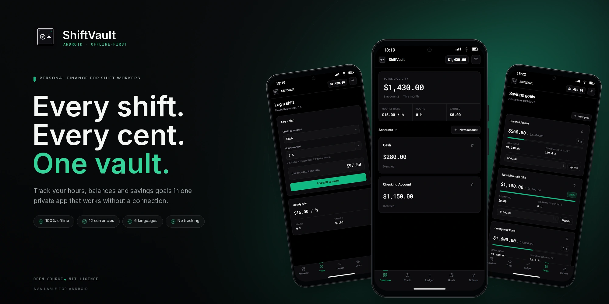
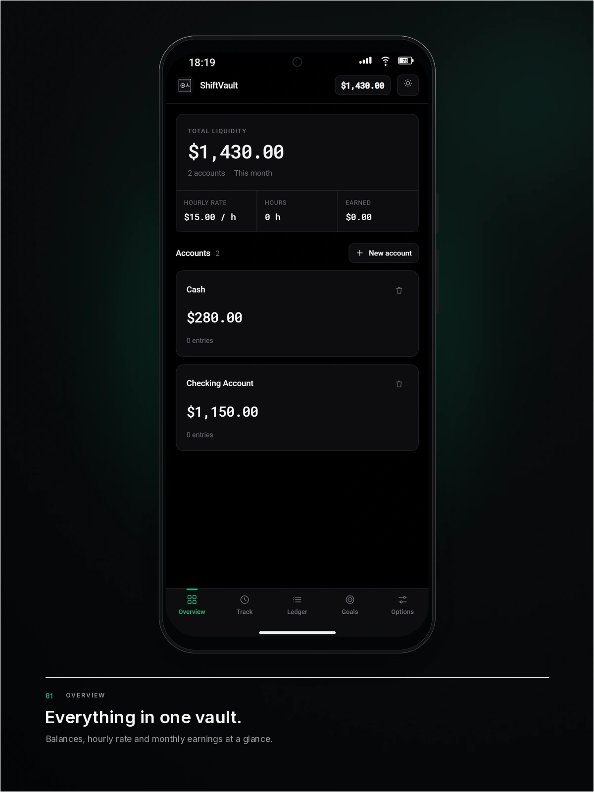
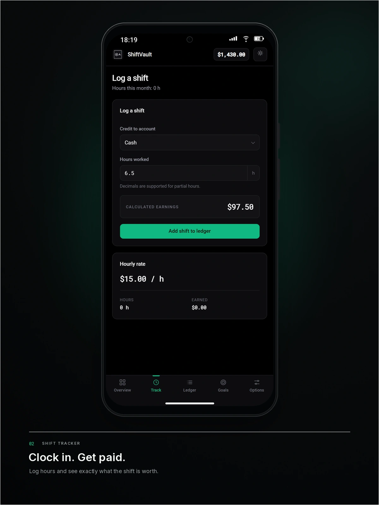
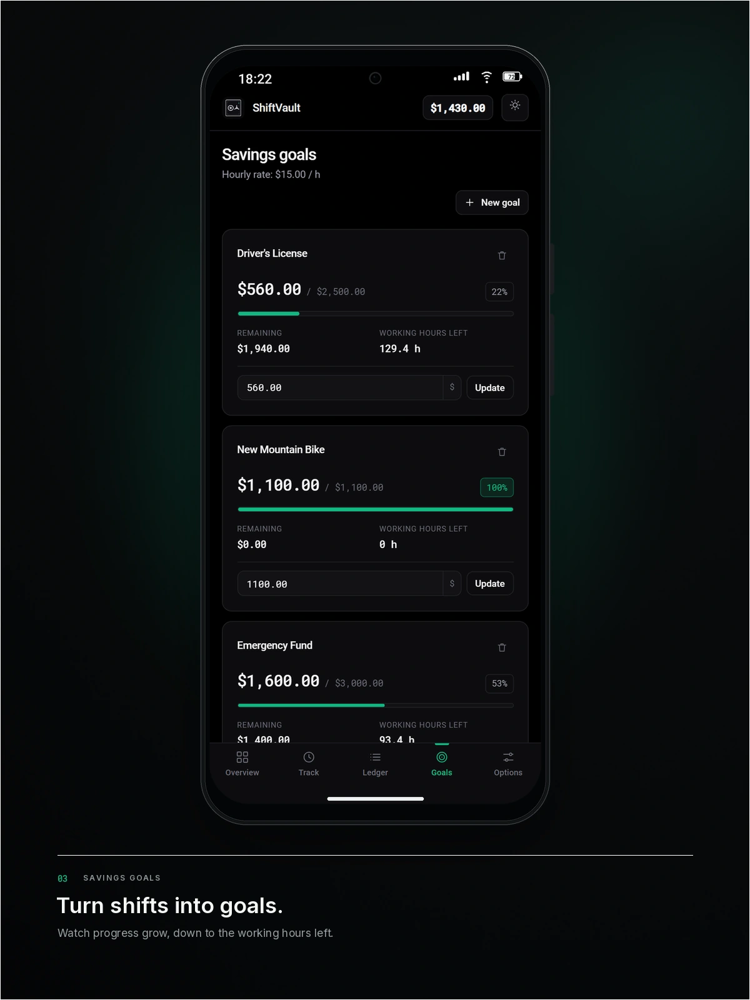
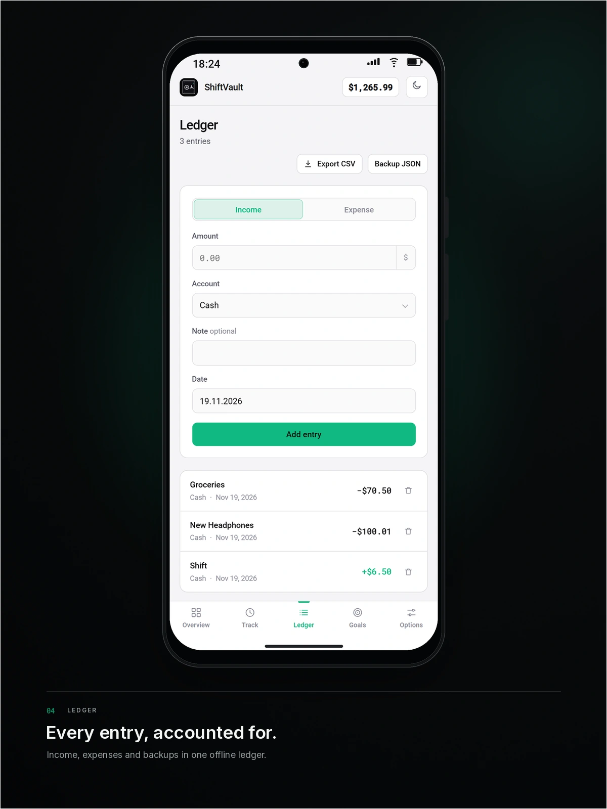
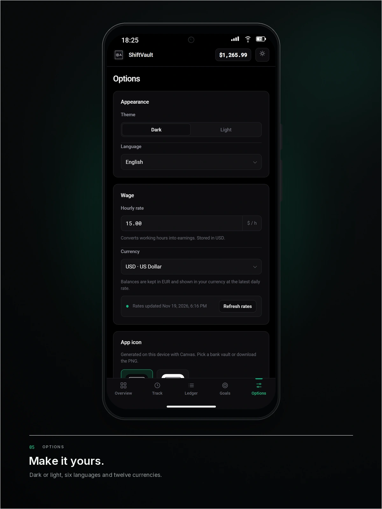

# ShiftVault

<p align="center">
  
</p>

<p align="center">
  <a href="https://github.com/AeroBaden/ShiftVault/releases/latest"></a>
  
  
  
  
</p>

ShiftVault is a free, open-source personal finance and shift tracker for Android. It combines a ledger for accounts and entries with a shift log, monthly goals and multi-currency support, and it keeps working without a connection.

The app is a Capacitor shell around a dependency-free web application in [`www/`](www). There is no backend, no account system and no telemetry. ShiftVault is Android-only for now.

## Install

**GitHub Releases** — download `ShiftVault-Android.apk` from the [latest release](https://github.com/AeroBaden/ShiftVault/releases/latest) and open it on your phone. Android asks once for permission to install unknown apps.

**Obtainium** — add `https://github.com/AeroBaden/ShiftVault` as an app source and Obtainium keeps ShiftVault up to date straight from the GitHub releases.

**F-Droid** — ShiftVault ships the store metadata F-Droid needs ([`fastlane/`](fastlane), recipe in [`docs/fdroid`](docs/fdroid)), but it is not in the official repository yet. The submission package and the remaining steps are documented there.

## Screenshots

<p align="center">
  
  
  
</p>
<p align="center">
  
  
</p>

<p align="center"><sub>Dark and light themes, shown in a Pixel 10 Pro frame.</sub></p>

## Features

- **Offline-first ledger** — accounts, income and expenses, running balances, categories and notes.
- **Shift tracker** — log shifts with date, hours and earnings, and review monthly totals.
- **Goals and insights** — monthly targets, progress and per-account breakdowns.
- **12 currencies** — amounts are stored per entry and formatted consistently. Exchange rates come from the Frankfurter API and are cached locally with a built-in fallback.
- **Six languages** — English, German, Spanish, French, Italian and Portuguese, switchable at any time.
- **Two themes** — an OLED-friendly dark theme with true `#000000` and a light theme with `#F4F4F6`.
- **Local backups** — export the ledger as CSV or as a complete JSON backup.
- **Vault identity** — a hand-drawn bank-vault icon with dark and light variants, including Android adaptive icons.

## Native Android polish

ShiftVault is not a plain web wrapper. The Android build adds:

- **Synchronised system bars** — the status bar and navigation bar follow the in-app theme:
  - Dark mode: `#000000` background with light system icons.
  - Light mode: `#F4F4F6` background with dark system icons.
- **Native haptics** — a light impact when switching tabs and a medium impact after logging a shift or adding a transaction.
- **Predictable back navigation** — the hardware back button and back gesture first close an open dialog or tutorial, then return to the **Track** tab, and only exit the app from there.
- **Safe-area layout** — `viewport-fit=cover` plus `env(safe-area-inset-top)` and `env(safe-area-inset-bottom)` keep the header below camera cutouts and the bottom navigation above the gesture bar. The sticky tab strip also accounts for the top inset.

## Privacy by design

- All accounts, entries, shifts, goals and settings are stored in the Android WebView's `localStorage`.
- There is no server, no sign-in, no analytics, no advertising and no tracking.
- The only outbound network request is an optional exchange-rate refresh to `api.frankfurter.dev`. If it fails, the app falls back to bundled reference rates and remains fully usable.
- The WebView loads local assets only. Export a JSON backup before uninstalling if you want to keep your data.

## Repository structure

```
shiftvault/
├── .github/workflows/
│   └── build-android.yml      # Android APK CI, optional release upload on v* tags
├── docs/
│   ├── fdroid/                # fdroiddata build recipe and submission checklist
│   └── showcase/              # README banner and Pixel 10 Pro screenshot mockups
├── fastlane/
│   └── metadata/android/      # F-Droid store listing: texts, icon, screenshots
├── assets/
│   └── android/               # launcher icon sets for dark/light and adaptive icons
├── scripts/
│   ├── gen-icons.py           # regenerates every PNG icon (Pillow)
│   ├── prepare-android.mjs    # icons, launcher aliases and native plugins
│   └── serve.mjs              # dependency-free static server for local previews
├── www/                       # the complete web application
│   ├── index.html
│   ├── style.css
│   ├── lang.js                # translations for six languages
│   ├── store.js               # localStorage state and data model
│   ├── fx.js                  # exchange rates, cache and formatting
│   ├── icon.js                # in-app Canvas vault icon generator
│   ├── app.js                 # views, forms, dialogs, exports, native bridge
│   ├── icon-dark.png
│   ├── icon-light.png
│   ├── icon-maskable.png
│   └── manifest.webmanifest
├── capacitor.config.json      # appId com.shiftvault.app, appName ShiftVault, webDir www
├── package.json               # Capacitor 6 dependencies and build scripts
├── LICENSE
└── README.md
```

`www/` is committed. `android/` is generated and ignored by Git.

## Requirements

| Task | Requirements |
| --- | --- |
| Web preview | Node.js 18+ (Node.js 20 recommended) |
| Android APK | Node.js 20, JDK 17, Android SDK (API 34) |
| Icon generation | Python 3 with Pillow (`pip install pillow`) |

Capacitor 6 is used deliberately: it is the current Capacitor line that targets JDK 17, which keeps the Android workflow reproducible on `ubuntu-latest`.

## Run the web app locally

The web app has no build step. Serve `www/` over HTTP so that `localStorage`, the manifest and the icon files behave as they do in the native shell:

```bash
npm ci
npm run serve
# http://localhost:3000
```

The native plugins are no-ops in a normal browser; the app degrades gracefully to the web experience.

## Android build (Capacitor)

### From GitHub Actions

1. Push to `main` or start **Build Android** manually from the **Actions** tab.
2. The workflow installs Node.js 20 and JDK 17, runs `npx cap add android`, installs the Vault icons and native plugins, syncs `www` and the Capacitor plugins, and runs `./gradlew assembleDebug`.
3. Open the completed run and download the **ShiftVault-Android** artifact. It contains `ShiftVault-Android.apk`.

The APK is a debug build signed with the standard Android debug key. It installs directly on a device (enable installation from unknown sources) and is intended for testing and sideloading, not for Play Store distribution.

### Locally

```bash
npm ci
npm run android:add      # npx cap add android + icons and native plugins
npx cap sync android     # copies www and the Capacitor plugins
cd android
./gradlew assembleDebug
```

The APK is written to `android/app/build/outputs/apk/debug/app-debug.apk`.

### Download from GitHub Releases

Pushing a tag that starts with `v` (for example `v1.0.0`) builds the APK and attaches `ShiftVault-Android.apk` to the matching GitHub Release automatically. You can also download the artifact from the workflow run at any time.

## Native implementation details

`capacitor.config.json` points Capacitor at `www` and sets the initial dark status bar. The web app talks to the native layer through `window.Capacitor`:

- `@capacitor/status-bar` sets the status bar style and background on every theme change.
- A generated native `SystemBars` plugin sets the navigation bar colour and the light/dark system icon appearance. It is written by `scripts/prepare-android.mjs` and registered in `MainActivity`, together with the `IconSwitch` plugin.
- `@capacitor/haptics` provides the impact feedback.
- `@capacitor/app` provides the `backButton` listener and `exitApp()`.

### Android launcher icons

`scripts/prepare-android.mjs`:

- copies the dark and light icon sets from `assets/android` into the native `res/` folders, including adaptive icons (`mipmap-anydpi-v26`) and legacy densities,
- moves the `LAUNCHER` intent filter from `MainActivity` to two `activity-alias` entries (`MainActivityDark` and `MainActivityLight`),
- generates and registers the native `IconSwitch` plugin so **Options → App icon** changes the actual home-screen icon.

The target alias is enabled before the other one is disabled, so the launcher never loses the icon. Some launchers cache icons briefly; a launcher restart may be needed. Pinned shortcuts and widgets keep the icon they were created with.

## Regenerating icons

```bash
pip install pillow
python3 scripts/gen-icons.py
```

This writes `www/icon-dark.png`, `www/icon-light.png`, `www/icon-maskable.png` and the complete Android launcher sets under `assets/android/`. The same vault artwork is drawn in `www/icon.js` for the in-app icon preview and PNG export, so update both if you change the design.

## Data and backups

- **CSV** — export the visible ledger for spreadsheets.
- **JSON** — export a complete backup of accounts, entries, shifts, goals and settings.

Backups are downloaded locally; nothing is uploaded.

## License

MIT — see [LICENSE](LICENSE).
